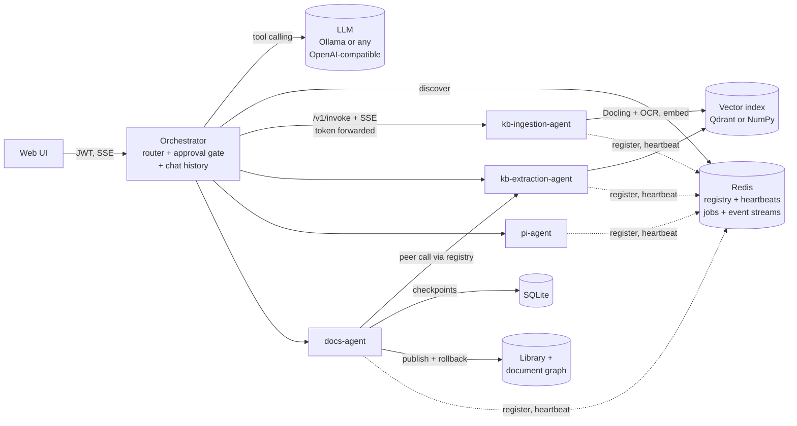

# Enginuity

**AI agents for engineering workflows.**

A multi-agent assistant for technical documents. People work in one chat; an orchestrator routes
each request to the right specialist agent, and a person stays in control of every step that
changes shared data. It ships with a small fictional equipment library, and it works the same on
any document you add: a manual, a policy, a report.

> **Demo project.** All sample data is synthetic: "Kestrel Industrial", its KP-200 pump and KC-50
> compressor do not exist. Runs fully locally on a small open model (Ollama), or on any
> OpenAI-compatible endpoint by changing three environment variables.

## What it does

| Ask | What happens |
|---|---|
| "How do I replace the mechanical seal on the KP-200?" | The KB agent searches the vector index and answers **only from the sources**, with page citations. It merges the manual with a newer service bulletin (a scanned PDF read with OCR). |
| "How often should the bearings be lubricated?" | Two machines match, so the agent **pauses and asks which one**; your reply resumes it. |
| "Extract the seal and impeller fitting steps from PI-0042" | The PI agent builds a **PageIndex** tree of the process instruction, the LLM picks the sections from the outline, and they come back as a Word file. |
| "Write a maintenance procedure for the KP-200 seal replacement" | The docs agent picks a **skill**, collects missing inputs, pulls sources from the KB agent, drafts, lets you **review and revise**, shows **which published documents share the same parts**, and publishes only on an explicit **yes**. |
| "Add this document to the knowledge base" | The orchestrator's **step approval gate** asks before an agent that writes to shared data is called. Any PDF or Word file works, scanned ones too. |
| "Write a document brief of *your document*" | A general-purpose skill (`document-brief`) drafts from that one document, in reading order, through the same review and publish loop. No equipment model needed. |
| A viewer asks to write a procedure | Refused: the role check runs **in code**, whatever the model chose. |

## Architecture



Every agent is its own FastAPI process built on `agentkit/`, which gives each one the same job API
(`/v1/invoke` → job id → SSE stream → `input_required` or `completed`), the same auth check, input
screening, agent card (`/.well-known/agent-card.json`) and registry heartbeat. An agent supplies only
a handler.

| Component | What to look at |
|---|---|
| **Orchestrator** | `orchestrator/app.py`: turn handling, approval gate, relaying an agent's question and resuming it, signed file links. `orchestrator/router.py`: tools built live from the registry. |
| **Registry** | `agentkit/registry.py`: an agent writes its card and refreshes a heartbeat with a TTL. Discovery returns only live agents, so a new agent is routable without a redeploy and a dead one drops out. |
| **KB ingestion** | `agents/kb_ingestion/`: Docling parsing; OCR only when a PDF has no text layer; the LLM picks structural, semantic or recursive chunking; MiniLM embeddings into Qdrant (stand-in for a managed search service) or a NumPy index. |
| **KB extraction** | `agents/kb_extraction/app.py`: vector search, answers only from the sources, citations checked in code, a "which one?" pause on ambiguity, and a `chunks` mode other agents call (best matches, or one whole document in reading order). |
| **PI agent** | `agents/pi_agent/`: a LangGraph supervisor over three sub-agents (parser → selector → writer). The selector reasons over a **PageIndex-style** tree (vectorless: section outline with page ranges) instead of embedded chunks. |
| **Docs agent** | `agents/docs_agent/`: each document type is a **`SKILL.md` folder** (inputs, sections, source query, authoring rules): a maintenance procedure, a system description and a document brief for any subject. The LangGraph workflow uses `interrupt()` for every human step and checkpoints to SQLite. |
| **Deterministic tools** | `agents/docs_agent/tools.py`: section layout, step numbering, part numbers checked against the catalogue, generated parts table, impact analysis, explicit-yes check, publish with rollback. |

## Design choices

- **The LLM decides what to do; code does anything that must be exact.** The model routes, picks a
  skill, extracts inputs and writes prose. Step numbers, part-number validation, parts tables, impact
  analysis and the publish are code.
- **Human in the loop, everywhere it matters.** Missing inputs, an ambiguous question, draft review
  and revision, publish approval and the orchestrator's step approval gate are all pauses that resume
  the same run. Paused runs survive a restart (SQLite checkpoint); the approval is checked by server
  code, and only an unqualified "yes" counts.
- **Security is not left to the prompt.** Roles are enforced in code at the orchestrator and again at
  each agent (the user's token is forwarded). User text is screened, then wrapped as data. Files are
  opaque ids with owner checks, downloads use 10-minute HMAC-signed links, and internal paths are
  scrubbed from replies. The agent call chain is capped to stop loops.
- **A private sandbox per visitor.** On the hosted demo each browser tab signs in as
  `<persona>~<random id>` (`agentkit/sandbox.py`). Chats, uploads and outputs are already per user;
  the knowledge base and the published library are filtered by sandbox, so one visitor's documents
  never reach another's search, impact analysis or document numbers. *Reset my sandbox* deletes
  them; the shared samples stay.

## Run it

Prerequisites: Python 3.11, Redis, [Ollama](https://ollama.com) with `qwen3:4b-instruct-2507-q4_K_M`
(or any OpenAI-compatible endpoint; see `.env.example`), and `tesseract-ocr` for scanned PDFs.

```bash
python3.11 -m venv .venv && . .venv/bin/activate
pip install torch==2.7.0 torchvision==0.22.0 --index-url https://download.pytorch.org/whl/cpu
pip install -r requirements.txt
ollama pull qwen3:4b-instruct-2507-q4_K_M

python scripts/make_samples.py       # synthetic manuals, PI, scanned bulletin, parts, library
python scripts/run_all.py            # orchestrator :8000 + 4 agents (add --qdrant to use Qdrant in Docker)
python scripts/seed.py               # in a second terminal: index the sample manuals
```

Open http://localhost:8000. Users: **asha** (author), **ravi** (viewer), **admin**; password `demo`.
The first Docling run downloads its layout models (about a minute).

```bash
python scripts/smoke.py              # drives every scenario through the API, as the UI does
python scripts/eval_routing.py       # routing accuracy on 22 labelled requests, against the real model
python -m pytest                     # 85 unit tests, no LLM or Redis needed
```

The routing eval caught real bugs during development:

- The small local model sometimes sent "How do I replace the seal?" to the documentation author
  instead of the Q&A agent. Sharper agent descriptions fixed it: 32/32 over two passes on
  `qwen3:4b-instruct` (the first 16 requests).
- `gpt-oss-20b` sometimes calls a tool that doesn't exist, named after the first word of a
  description ("authors"). The router maps such a name only when it fits exactly one tool, and
  otherwise asks again with the list of real tool names. The eval lists agents in the registry's
  order, because the order changes what the model does. `gpt-oss-120b`: 22/22.

Reset the demo data: stop the stack, then `rm -rf storage && redis-cli -n 5 flushdb`, and seed again.

## Hosted demo (Streamlit Community Cloud)

`streamlit_demo/streamlit_app.py` runs the same system on a free Streamlit host:

- **One process.** The orchestrator and the four agents run as separate HTTP servers in one process,
  so a single copy of torch fits the free tier's memory. Each agent keeps its own port, registry
  entry, heartbeat and API.
- **Own Redis.** The app starts `redis-server`, which is installed from `packages.txt`.
- **Fast start.** The sample knowledge base loads from `demo_snapshot/`, so the samples are not
  re-parsed on every start. To rebuild the snapshot: `python scripts/snapshot.py`.
- **Model.** The LLM is Groq's `openai/gpt-oss-20b` (see the routing eval above). Groq's free tier
  allows about 200,000 tokens a day per model, so `openai/gpt-oss-120b` takes over when that runs
  out (`LLM_FALLBACK_MODELS`); a limited model is skipped until its limit resets, and when every
  model is limited the chat says so instead of failing silently.
- **Same client.** The page is a client of the orchestrator's API, like the web UI.
- **Built for first-time visitors.** One-click examples for each agent, a *Use your own document*
  path (upload → approve → ask, extract or brief) and a private sandbox per browser tab.

To deploy, go to [share.streamlit.io](https://share.streamlit.io) and choose **Create app**:

1. Pick this repository, branch `main`, main file `streamlit_demo/streamlit_app.py`.
2. Under **Advanced settings**, choose Python **3.11** and add the secret `GROQ_API_KEY = "..."`.

Optional secrets: `LLM_MODEL`, `LLM_BASE_URL`, `LLM_API_KEY` (any OpenAI-compatible provider) and
`JWT_SECRET`.

## Demo script (about 3 minutes)

1. Sign in as **asha**. Point at *Agents online*: four agents, live heartbeats.
2. *Ask a question* → the seal question. Open *How this was handled*: router → KB agent → a cited
   answer that uses the scanned bulletin's newer seal.
3. *What is the supply voltage?* It asks which machine; click one.
4. *Extract steps* → a PI-0042 example. Open the Word file.
5. *Write a document* → the KC-50 filter procedure. Ask for one change, approve, read the impact
   list, say **yes**.
6. *Use your own document*: upload any PDF, add it (approve the step), ask a question about it,
   then *Write a brief* of it.
7. *Guardrails*: Ravi (viewer) asks for a procedure and is refused in code; a prompt injection is
   blocked before any model sees it.
8. Add a document type live: sign in as **admin** and switch on *Troubleshooting-guide document
   type* (locally: copy `examples/skills/troubleshooting-guide` into `agents/docs_agent/skills/` and
   click *Reload docs-agent skills*), then ask for a KP-200 troubleshooting guide.
9. Optional, locally: stop the docs agent mid-review, start it again, and approve. The run resumes
   from its checkpoint.

## What is simplified

This is a demo, so some production pieces are stand-ins:

| Here | In a production deployment |
|---|---|
| Local folder + Redis metadata for files | Blob storage with SAS links |
| NumPy index or Qdrant | A managed vector search service |
| Demo users with HS256 JWTs | An identity provider (OIDC) with role claims |
| A sandbox per browser tab, keyed by a random id | Tenants and accounts from the identity provider |
| One shared Redis, SQLite checkpoints | Managed Redis, Redis or Postgres checkpointer across replicas |
| Images in documents are counted, not classified | A vision model keeps technical diagrams and drops decorative ones |
| Processes on one machine | Containers on Kubernetes behind an API gateway |
